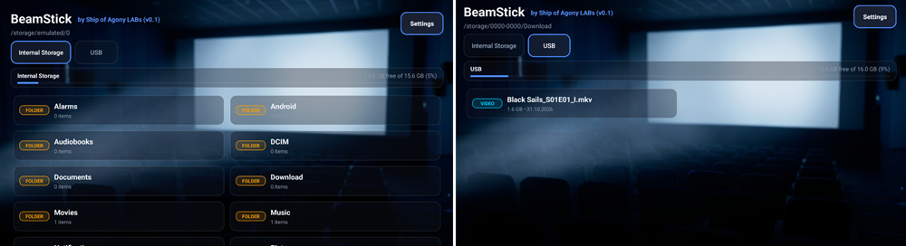

<p align="center">
  <a href="https://apps.obtainium.imranr.dev/redirect?r=obtainium%3A%2F%2Fapp%2F%7B%22id%22%3A%22com.example.beamsticklauncher%22%2C%22url%22%3A%22https%3A%2F%2Fgithub.com%2FShip-of-Agony%2FBeamStick%22%2C%22author%22%3A%22Ship-of-Agony%22%2C%22name%22%3A%22BeamStick%20Launcher%22%2C%22preferredApkIndex%22%3A0%2C%22additionalSettings%22%3A%22%7B%5C%22includePrereleases%5C%22%3Afalse%2C%5C%22fallbackToOlderReleases%5C%22%3Atrue%2C%5C%22filterReleaseTitlesByRegEx%5C%22%3A%5C%22%5C%22%2C%5C%22filterReleaseNotesByRegEx%5C%22%3A%5C%22%5C%22%2C%5C%22verifyLatestTag%5C%22%3Afalse%2C%5C%22sortMethodChoice%5C%22%3A%5C%22date%5C%22%2C%5C%22useLatestAssetDateAsReleaseDate%5C%22%3Afalse%2C%5C%22releaseTitleAsVersion%5C%22%3Afalse%2C%5C%22trackOnly%5C%22%3Afalse%2C%5C%22versionExtractionRegEx%5C%22%3A%5C%22%5C%22%2C%5C%22matchGroupToUse%5C%22%3A%5C%22%5C%22%2C%5C%22versionDetection%5C%22%3Atrue%2C%5C%22releaseDateAsVersion%5C%22%3Afalse%2C%5C%22useVersionCodeAsOSVersion%5C%22%3Afalse%2C%5C%22apkFilterRegEx%5C%22%3A%5C%22%5C%22%2C%5C%22invertAPKFilter%5C%22%3Afalse%2C%5C%22autoApkFilterByArch%5C%22%3Atrue%2C%5C%22appName%5C%22%3A%5C%22%5C%22%2C%5C%22appAuthor%5C%22%3A%5C%22%5C%22%2C%5C%22shizukuPretendToBeGooglePlay%5C%22%3Afalse%2C%5C%22allowInsecure%5C%22%3Afalse%2C%5C%22exemptFromBackgroundUpdates%5C%22%3Afalse%2C%5C%22skipUpdateNotifications%5C%22%3Afalse%2C%5C%22about%5C%22%3A%5C%22%5C%22%2C%5C%22refreshBeforeDownload%5C%22%3Afalse%2C%5C%22includeZips%5C%22%3Afalse%2C%5C%22zippedApkFilterRegEx%5C%22%3A%5C%22%5C%22%7D%22%2C%22overrideSource%22%3Anull%7D">
    
  </a>
</p>

<p align="center">
  <a href="https://github.com/Ship-of-Agony/BeamStick/releases/latest">
    
  </a>
  
  
  <a href="LICENSE">
    
  </a>
</p>

# 🎬 BeamStick Launcher (v0.2)

**D-Pad-optimized Android TV & projector media bridge launcher for external storage.**  
Developed by **Ship of Agony LABs**.

BeamStick is a streamlined, lightweight media launcher designed specifically for Android TV sticks, TV boxes, and smart projectors. Instead of clunky navigation or desktop-style layouts, BeamStick delivers a zero-friction experience centered around physical directional remotes (D-Pads), instant removable media browsing, and smart hardware auto-launching.

<p align="center">
  
</p>

---

## ⚡ Highlights

- **🎛️ D-Pad Native Focus:** Strict focus management and responsive grid navigation tailored purely for remote controls without touch input.
- **🔌 Intelligent USB Autostart & Hotplug:** Launches on device boot only if a physical USB stick is actually attached (with a 5-second mounting delay). Plugging in a USB drive during runtime opens the launcher automatically.
- **💾 Dual-Storage Switcher:** Automatic real-time detection with localized labels for *Interner Speicher* / *Internal Storage* and dynamic USB drive enumeration (`USB`, `USB 1`, etc.).
- **🛡️ Persistent Permission Locks:** Fully compatible with Android 11 through Android 14. Binds storage and overlay permissions directly via UID to prevent unwanted re-prompt dialogs after reboot.
- **🎬 Direct Player Integration:** Extensive package query support ensures installed third-party video players (VLC, Nova, Just Player, MX Player) open directly without redirects to the Google Play Store.
- **📺 Native TV Leanback Banner:** Integrated 16:9 home screen tile (`banner_beamstick.png`) for seamless Android TV launcher rendering.

---

## 📦 Storage & File System Routing

| Storage Target | Display Label | Behavior / Source |
| :--- | :--- | :--- |
| **Primary Storage** | `Interner Speicher` / `Internal Storage` | Primary device internal storage directory (`/storage/emulated/0`) |
| **USB Media Drive(s)** | `USB` / `USB 1`, `USB 2`, ... | Dynamic removable OTG/USB drives mounted via SAF |

---

## 🚀 Installation & Setup

### Method 1: Automated Deployment via `BeamStick_Helper.bat` (Recommended)

For full Android 14 compatibility (automatic autostart on USB attach, permanent full storage access without recurring prompts, and battery optimization whitelist), use the automated maintenance script:

1. **Download ADB Tools:** Download the BeamStick_Helper.zip repository under [BeamStick](https://github.com/Ship-of-Agony/BeamStick).
2. **Download Latest Release:** Download the latest `BeamStick` APK from the [Releases](https://github.com/Ship-of-Agony/BeamStick/releases) page and place it into that exact same folder.
3. **Run Script:** Ensure USB Debugging (or Network ADB) is enabled on your projector/TV stick, then double-click `BeamStick_Helper.bat`.
   - The script auto-detects your system language (German/English).
   - Select **Option 2** (Update) or **Option 3** (Clean Reinstall) to deploy the APK and permanently lock all permissions via kernel UID.

```text
BeamStick_Helper/
├── adb.exe
├── AdbWinApi.dll
├── AdbWinUsbApi.dll
├── BeamStick_Helper.bat
└── BeamStick-v0.2.apk
```

### Method 2: Direct Install / Obtainium

- **Direct APK:** Download the latest `BeamStick` APK from the [Releases](https://github.com/Ship-of-Agony/BeamStick/releases) page and install it using your preferred file manager.
- **Obtainium:** Add `https://github.com/Ship-of-Agony/BeamStick` to your Obtainium tracker for automated update management (or click the Obtainium badge at the top).

*Note: When installing manually without the Helper script, you may need to manually grant "All files access" via Android System Settings.*

### Method 3: Manual Sideload via Command Line (Optional)

If installing via standard ADB command line:

```bash
adb install -r -d BeamStick-v0.2.apk
```

---

## 🗑️ Uninstallation

Uninstall BeamStick from your Android TV or projector device using one of the following methods:

### Method 1: Via `BeamStick_Helper.bat` (Recommended)
Launch `BeamStick_Helper.bat` on your PC and select **[4] Uninstall** to completely remove the application and its AppOps bindings.

### Method 2: Android System Settings
1. Open Android TV **Settings** ⚙️.
2. Navigate to **Apps** (or **Device Preferences** → **Apps** → **See all apps**).
3. Locate and select **BeamStick**.
4. Click **Uninstall** and confirm.

### Method 3: Via Obtainium
If managed via Obtainium:
1. Open **Obtainium**.
2. Select **BeamStick**.
3. Tap the **Trash / Uninstall** icon at the top right.

### Method 4: Via ADB (Command Line)
Connect your device with USB Debugging enabled and run:

```bash
adb uninstall com.example.beamsticklauncher
```

---

## 🛠️ Tech Stack & Requirements

- **Minimum SDK:** 26 (Android 8.0 Oreo)
- **Target SDK:** 35 / 36 (Android 15 / 16)
- **Architecture:** Kotlin, Coroutines, AndroidX Leanback Support
- **Core APIs:** Storage Access Framework (`DocumentFile`), `StatFs`, AppOps Manager

---

## 📄 License & Open-Source Credits

### License

**BeamStick**  
© 2026 Ship of Agony LABs

This application is licensed under the **Apache License, Version 2.0** (the "License"). You may not use these files except in compliance with the License. You may obtain a copy of the License at:

[http://www.apache.org/licenses/LICENSE-2.0](http://www.apache.org/licenses/LICENSE-2.0)

Unless required by applicable law or agreed to in writing, software distributed under the License is distributed on an "AS IS" BASIS, WITHOUT WARRANTIES OR CONDITIONS OF ANY KIND, either express or implied. See the License for the specific language governing permissions and limitations under the License.
